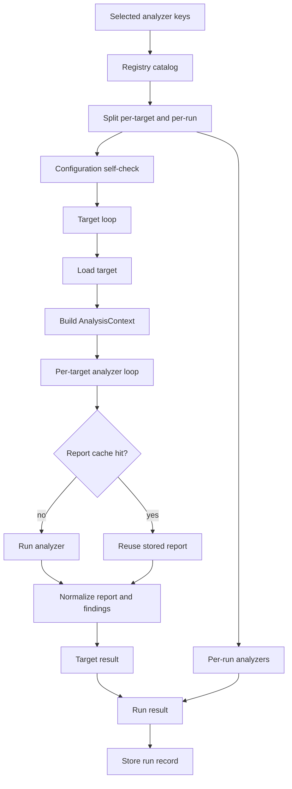

# Analysis Pipeline

An analysis run is a deterministic pipeline: select analyzers, validate the
configuration, load each target, run analyzers, normalize findings, and store a
run record. The CLI and the interactive shell use the same pipeline.

## Pipeline at a glance

## 1. Selection

Entry points:

- `sattlint analyze` through `cli/commands.py`;
- the interactive Analyze view through the application handlers.

The command line resolves analyzer keys first:

1. `--analyzer` values, when present;
2. otherwise the project's `analyzers` list;
3. otherwise a usage error that lists every selectable key.

Keys are canonicalized for case and documented compatibility aliases, then
matched against the registry. Unknown keys are a usage error.

The registry returns `AnalyzerSpec` values. Nothing is added to the selection.

## 2. Partitioning by scope

The selected specs are split into:

- per-target analyzers, which run once for every loaded target;
- per-run analyzers, which run once for the whole run.

ICF configuration is the per-run analyzer. If the selection contains only
per-run analyzers, SattLint does not load any target; loading would pay the
parse cost for nothing.

## 3. Configuration self-check

Before loading, SattLint runs the configuration self-check. It reports the
Python version, required configuration keys, directories, targets, and analyzer
settings. A failure aborts the run before a target is loaded.

## 4. Target loop

For every configured target, the project application loads a target:

1. The loader checks the AST cache.
2. A valid cached graph is returned with cache metadata.
3. Otherwise the parser loads the target closure and the loader indexes it.
4. The graph records failures, warnings, unavailable libraries, and timings.

A target that cannot be loaded is recorded as a load failure. The run continues
to other targets so the user sees every failure; the headless analyze command
then fails as a whole when any selected target failed to load.

The loop releases each target graph before loading the next one so two complete
projects are not held at the same time.

## 5. Analysis context

For each target, `execute_target` builds one `AnalysisContext` shared by every
per-target analyzer for that target. The context carries:

- the loaded base picture;
- the project graph;
- the effective configuration;
- debug state;
- whether the target is a library;
- the string capacities;
- the unavailable-library set;
- program loaders for analyzers that need them;
- shared analysis artifacts.

The context is the only input an analyzer receives. Analyzers do not reach into
the application layer.

## 6. Analyzer execution

Each per-target analyzer runs in selection order:

1. The analyzer's name and key are written to the session output.
2. The framework tries the analysis report cache.
3. On a miss, the analyzer's `run(context)` is called.
4. The report is post-processed:
   - declaration-path findings are rewritten to the inspected instance where
     appropriate;
   - the report target name is normalized;
   - issues are extracted into structured findings.
5. The analyzer result records status, summary, report kind, issue count,
   findings, duration, and phase timings.

A report-cache hit reuses the stored report without re-running the analyzer.
The cache key covers the project cache key, the analyzer key, the analyzer's
version marker, and the effective analyzer settings.

### Parallel analyzer execution

Analyzers are pure Python, so a thread cannot overlap two of them: the
interpreter lock serializes them anyway. Processes can overlap. When a target
selects more than one analyzer, `execute_target` forks a worker pool after the
graph is loaded:

- the parent loads the target once and forks afterwards, so the workers inherit
  the parsed graph copy-on-write instead of loading or pickling it again;
- each worker runs one analyzer at a time and returns a plain result record;
- analyzers that share work are grouped into one job so the second one reuses
  what the first published instead of recomputing it (`variables` and
  `datatype-fields`);
- the parent drains the results in selection order, so the printed sections and
  the stored run record stay deterministic even though the analyzers finish out
  of order;
- anything an analyzer prints is captured in its worker and printed with that
  analyzer's section;
- a worker that raises returns a failure record instead of taking the pool down;
- cancelling the run terminates the workers immediately.

The worker count comes from `--jobs`; `0` (the default) picks a count from the
analyzer count and the CPU count, capped at a small number because a run is
bounded by its slowest analyzer. `--jobs 1` keeps every analyzer in one process.

Two properties of the design are worth knowing:

- Analyzers may reuse another analyzer's shared artifacts as an optimization
  (the `variables` collector publishes views for derived analyzers). Each worker
  starts from the state the parent had at fork time, so a worker recomputes what
  it needs instead of reading a sibling worker's memory. That costs time, never
  correctness: every analyzer can run standalone.
- Platforms without the `fork` start method keep the single-process loop. A
  spawned worker would reload the project graph per worker, which costs more
  than the analyzers it saves.

## 7. Failure isolation

A per-target analyzer that raises is recorded as failed:

- the run continues with the remaining analyzers;
- the failure message names the exception type in normal mode;
- debug mode includes the full exception text;
- the headless command treats an analyzer failure as a run failure with exit
  code `2`, because a partial result would be misleading.

A per-run analyzer failure is recorded the same way and does not abort the
other per-run analyzers.

Cancellation is separate from failure. A `KeyboardInterrupt` marks the run
cancelled, keeps results already produced, and returns exit code `130`.

## 8. Per-run analyzers

After the target loop, per-run analyzers execute in selection order. They get a
context with no target base picture and can use the program loaders to inspect
whatever the configuration describes. ICF validation uses this path to load
every referenced program once per session.

Per-run results are stored as project-level analyzer records rather than under a
target.

## 9. Result assembly

The run result contains:

- output lines for the session log;
- target results, each with analyzer results;
- project-level per-run results;
- the selected analyzer keys;
- cancellation state;
- load failure records;
- the run ID when the run was stored.

## 10. Finding normalization

Reports expose different issue shapes. The findings layer normalizes them into
one immutable `AnalysisFinding`:

- kind;
- message;
- module path;
- optional rule identifier;
- optional explanation and suggestion;
- structured data.

It also fills common display fields such as site, context, and relation from
issue models that carry them. The same normalized finding feeds the CLI, the
results tree, and run history.

## 11. Run persistence

Runs are stored unless `--no-save` is passed or run history is disabled. The
record captures:

- run identity and timestamps;
- project tag and project path;
- selected analyzers;
- target records with analyzer records and findings;
- project-level analyzer records;
- the module tree snapshot;
- session output lines;
- load and analyzer timings;
- cancellation state.

Run IDs are sortable and unique. A stored run can later be queried with
`findings` and `show`.

## 12. Interactive execution

The Textual shell can run the analysis in a short-lived child process. The child
process loads targets, runs analyzers, and stores the run. The shell then loads
the run record instead of retaining the parsed graphs and analyzer indexes in
the UI process.

This keeps the interactive application responsive and keeps analysis memory
from accumulating across repeated runs.

## Profiling

When profiling is enabled through the environment, the pipeline records:

- per-target load stage timings;
- graphics timings;
- per-analyzer durations;
- analyzer phase timings;
- the slowest analyzer and slowest phase.

Profiling writes a JSONL log under the cache directory and never changes
analysis results.

## Related pages

- [Analyzers](analyzers.md)
- [Project loading](project-loading.md)
- [Caching and runs](caching-and-runs.md)
- [Resolution and semantics](resolution-and-semantics.md)
- [CLI reference](cli.md)
