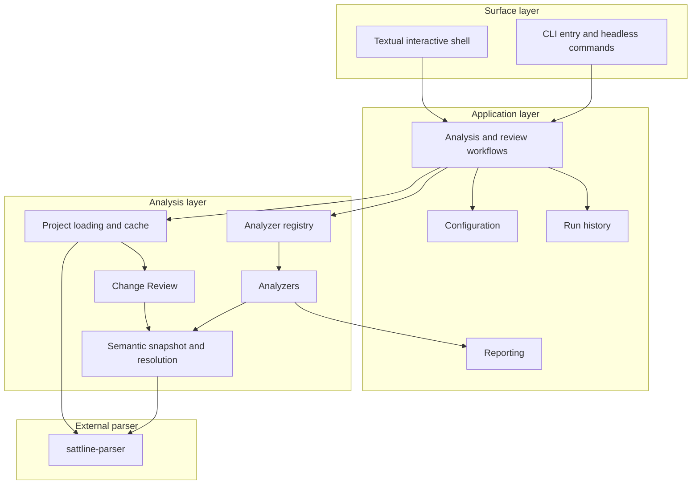
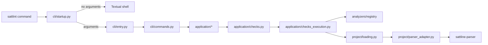

# Architecture

SattLint is layered so the parser boundary, the application workflows, and the
presentation surfaces stay independent. This page is the detailed architecture
guide; [ARCHITECTURE.md](../ARCHITECTURE.md) is the short summary, and
`AGENTS_REFERENCE.md` holds the repository operating rules.

## Layers

Dependency direction is downward. The parser does not import SattLint. The UI
does not own analysis logic. Analyzers do not import the project loader
directly; the application layer passes loader callables through the analysis
context.

## Source layout

| Path | Owns |
| --- | --- |
| `src/sattlint/cli/` | Command-line parser, headless commands, startup, menu text, console interaction bridge. |
| `src/sattlint/ui/` | Textual application, screens, widgets, view state, keyboard behavior. |
| `src/sattlint/application/` | Terminal-agnostic workflows: project orchestration, checks execution, findings, run records, output, Change Review entry, subprocess analysis. |
| `src/sattlint/config/` | Configuration types, defaults, validation, TOML I/O, paths, string capacities, self-check. |
| `src/sattlint/project/` | `.slproj` model and I/O, parser binding, parser adapter, loading orchestration, project support helpers, project cache bridge. |
| `src/sattlint/core/` | Semantic snapshot, semantic index, syntax helpers, call signatures, origin matching, logging, profiling, timings, terminal utilities. |
| `src/sattlint/resolution/` | Canonical paths and symbol table, record type graph, scope contexts, access graph, module-type resolution, alias helpers. |
| `src/sattlint/analyzers/` | Analyzer implementations, registry, framework primitives, shared helpers, plugin API, string inference. |
| `src/sattlint/models/` | Project graph, variable issue models, validation notices, usage models. |
| `src/sattlint/graphics/` | Graphics companion attachment, PictureDisplay path resolution, asset checks. |
| `src/sattlint/validation/` | Policy over parser diagnostics and shared structural error types. |
| `src/sattlint/reporting/` | Report models and human-readable rendering. |
| `src/sattlint/runs/` | Run record types, persistence, stable finding acknowledgement keys. |
| `src/sattlint/change_review/` | Semantic diff, impact selection, review model, serialization, artifacts. |
| `src/sattlint/cache/` | AST cache, analysis report cache, cache key construction, pruning. |
| `src/sattlint/utils/` | Small shared utilities such as casefolding, comment scanning, repository paths. |
| `src/sattlint/parser_api.py` | The single import surface for the external parser package. |

## Runtime entry points

- `sattlint` with no arguments requires a terminal on stdin and stdout, then
  loads the user configuration, configures logging, checks that Textual is
  available, and starts the shell. Without a terminal it prints the usage and
  exits 2.
- `sattlint <command>` parses arguments first. Errors are reported as stable CLI
  error envelopes; the interactive shell is never started.
- `python -m sattlint` delegates to the same CLI entry point.

## Application workflows

The application layer is the seam shared by both surfaces:

- `application/project.py` exposes project iteration, target loading, library
  detection, source selection, and AST cache refresh.
- `application/analyze.py` exposes the public analysis actions.
- `application/checks.py` owns a run: analyzer selection, self-check, target
  iteration, per-run analyzers, cancellation, and run persistence.
- `application/checks_execution.py` owns one target's analyzer loop, report
  cache lookup, analyzer failure isolation, and timing collection.
- `application/analyzer_workers.py` runs one analyzer and, when a target selects
  several, spreads them across forked workers that inherit the loaded graph.
- `application/checks_results.py` defines typed target and run results.
- `application/findings.py` normalizes heterogeneous report issues into the
  single finding model.
- `application/checks_records.py` converts a result into a stored run record.
- `application/change_review.py` binds Change Review generation to the
  configured project for the UI.
- `application/subprocess_analysis.py` runs an interactive analysis in a
  short-lived child process so the UI does not retain a large analysis heap.
  The child starts with the interpreter's safe-path mode (`-P` and
  `PYTHONSAFEPATH=1`), so a module in the analyzed project directory cannot
  shadow the installed package.

## Parser boundary

`sattline-parser` is a pinned external dependency. It owns:

- file discovery and official/draft resolution;
- dependency resolution and cycle detection;
- parsing and AST models;
- language validation diagnostics;
- graphics companion scanning;
- the project load graph.

SattLint owns:

- parser binding from configuration;
- translation of parser diagnostics into SattLint policy;
- semantic validation and indexing into `ProjectGraph`;
- graphics attachment, workspace asset verification, and notice wording;
- analyzers, reporting, run history, and presentation.

`src/sattlint/parser_api.py` is the only module that re-exports parser API
symbols. This keeps an import boundary that tests can verify and makes a parser
upgrade a deliberate, reviewable change.

## Project graph and semantic snapshot

Two related structures represent a loaded project:

**`ProjectGraph`** is the analysis index. It holds:

- parsed base pictures by name;
- root origins and source files;
- module-type and datatype definitions keyed by library, name, and file;
- library and source dependencies;
- missing programs, warnings, and typed failures;
- unavailable libraries;
- cache metadata;
- load and graphics timings;
- graphics attachments.

**`SemanticSnapshot`** is the query facade built from a loaded project. It
holds canonical symbol definitions, a symbol table, a type graph, references,
and call signatures. It is immutable, and its lookup methods are
case-insensitive.

See [Project loading](project-loading.md) and
[Resolution and semantics](resolution-and-semantics.md).

## Error policy

SattLint distinguishes policy from language rules:

- The parser reports language diagnostics.
- SattLint decides which diagnostics are fatal and how they are worded.
- A strict validation path raises the first structural error.
- A project load is all or nothing: a target's complete declared closure is
  returned or the load fails.
- An analyzer failure is isolated and recorded; it does not abort the whole run
  unless the command considers analyzer failure fatal.
- A target load failure is recorded, and an unmatched target makes the headless
  analyze command exit `2`. When other targets loaded, their findings are still
  reported and the failed targets are marked, but the partial run is not saved.

Failures are explicit. There are no silent fallbacks that turn a broken project
into a partial analysis result.

## Typing and boundaries

- Production code outside `src/sattlint/ui/` is Pyright strict-clean.
- The Textual shell is excluded from strict type analysis because it drives
  dynamic widget APIs; it is exercised by the full test suite instead.
- Typed records and dataclasses are preferred over ad-hoc dictionaries and
  tuples.
- Dispatch uses typed callables rather than reflection.
- Case-insensitive identifiers are compared with `casefold`.

## Quality boundaries

- `tests/test_dependency_guard.py` enforces the parser and layering boundary.
- Analyzer architecture tests enforce registry and helper ownership rules.
- The analyzer registry is the only rule catalog; CLI, UI, and reporting read
  from it instead of duplicating analyzer lists.
- The docs checker enforces link resolution and documentation reachability.

## Related pages

- [Project loading](project-loading.md)
- [Analysis pipeline](analysis-pipeline.md)
- [Resolution and semantics](resolution-and-semantics.md)
- [Caching and runs](caching-and-runs.md)
- [Change Review](change-review.md)
- [Testing](testing.md)
