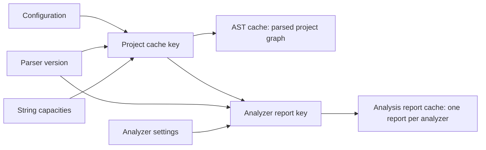

# Caching and Runs

SattLint stores parsed projects, analyzer reports, run history, and profile
events under the platform cache directory. Every stored artifact is an
optimization or a convenience: analysis still works when the directory is
unavailable.

## Cache location

| Platform | Cache root |
| --- | --- |
| Linux | `$XDG_CACHE_HOME/sattlint`, or `~/.cache/sattlint` |
| Windows | `%APPDATA%\sattlint\cache` |

The directory is created on demand. Nothing is read from or migrated out of an
older cache location.

## Two caches



### AST cache

The AST cache stores a validated loaded project graph for one target.

- The key is derived from the parser version, the analysis target, and every
  configuration key that affects loading: mode, roots, and string capacities.
  The configured target list is not part of it: a target's parsed graph does not
  depend on which other targets were selected, so filtering a run with
  `--target` reuses the same entries.
- The payload is a signed pickle containing the root picture and project graph.
- The manifest is a signed JSON snapshot of every file that contributed to the
  load: source files, graphics companions, distribution companions, dependency
  sidecars, and the ICF directory and files. It carries its own magic and
  HMAC-SHA256 signature, so a manifest rewritten without the key is a miss even
  when the payload beside it is genuine.
- A cached entry is reused only when its manifest still matches the files on
  disk.

A manifest that includes a directory records the directory itself, so adding a
new ICF file invalidates the entry even though the old file list has not
changed.

### Analysis report cache

The analysis report cache stores one analyzer report per target and analyzer.

- The key combines the project cache key, the analyzer key, the analyzer's
  version marker, and the effective analyzer settings.
- The whole `[analysis]` mapping is fingerprinted as analyzer settings. The
  three byte limits (`source_byte_limit`, `icf_byte_limit`, and
  `project_byte_limit`) are therefore part of the analysis-report key even
  though they are not part of the project cache key: they bound input size,
  not the parsed project graph.
- The analyzer version marker changes when that analyzer's behavior changes, so
  an upgrade does not replay an old report. A test pins a digest of each
  analyzer's implementation, so editing one without bumping its marker fails
  the suite instead of shipping a stale cache.
- The payload includes the report and a file manifest; the manifest is
  validated before the report is used.
- The cache is stored under a directory named for the report schema version and
  the parser version. Entries from another generation are pruned instead of
  read.

The semantic foundation is not persisted. It holds references to parser objects
from one specific parse, so restoring it from disk would create identity
mismatches. Reusing the parsed ASTs is the supported cold-start saving.

### Parser per-file cache

Below both of these sits the parser's own per-file cache. SattLint always
enables it, for parsing and for a graph rebuild alike, because a hit cannot be
stale: the parser filters on the file's modification time and size and then
confirms the entry with a SHA-256 digest of the exact bytes that were parsed.
The entry namespace also covers the parser version, the grammar fingerprint,
the parser stack versions, and every file the parser ships. A rebuild therefore
re-resolves and re-indexes the project without re-parsing unchanged files.

## Cache safety

- Payloads are written through a temporary file and an atomic replace.
- Payloads are owner-only.
- Pickle payloads carry a magic header and an HMAC-SHA256 signature.
- The signing key lives one level above the cache root, so copying or clearing
  the cache tree does not copy the key along with the data.
- A missing key means a payload cannot be verified and is treated as a miss.
- Manifests are signed with the same key as payloads, so replacing the manifest
  alone cannot pair a signed old payload with a new file snapshot.
- Both the payload and the manifest record the cache key they were written for.
  An entry copied onto another key is a miss, so write access to the cache
  directory cannot make one target analyze another target's graph.
- The signing key is trusted only when it is a regular file of the expected size,
  owned by the current user, and inaccessible to group and other. A symlink, a
  foreign owner, or a wider mode makes the entry a miss rather than following the
  file.
- Pickle payloads are decoded by a restricted unpickler that resolves only the
  SattLint and parser model modules plus named standard library objects. A
  crafted payload therefore cannot reach introspection helpers, code builders, a
  process launch, or another arbitrary callable, even when it carries a valid
  signature.
- A failed write is logged and the run continues.
- An unusable cache directory degrades to an uncached run.

## Cache invalidation

An entry is invalid when any of these changes:

- the parser version;
- the cache schema or payload version;
- the cached project and AST model version;
- the analysis target;
- the project roots, targets, or mode;
- the string capacity table;
- the analyzer settings;
- the behavior version of the analyzer that produced a report;
- any file in the manifest, including its size or modification time.

Deleting a file from the manifest is also a mismatch because the manifest
tracks the exact set of files.

## Pruning and clearing

The cache manager can:

- prune stale entries, including entries from another cache generation;
- clear all AST and report cache entries;
- remove orphaned payloads or manifests.

A startup prune removes entries that are structurally invalid or belong to
another generation. It does not delete a valid entry just because it is old;
freshness is decided by the manifest.

The AST cache also enforces a payload budget after every save. Once the payload
family exceeds 4 GiB, the least recently used entries are removed, and entries
written within the last seven days are never evicted.

The interactive shell exposes cache maintenance through its application flows.
The headless CLI exposes two separate switches on `analyze`, one per decision:

- `--no-cache` ignores stored analyzer reports and re-runs every analyzer. The
  parsed project graph is still reused.
- `--refresh-ast` rebuilds each target's parsed project graph. The parser's
  per-file cache is still reused, so only resolution and indexing are redone.

Neither switch changes which files are read: the parser verifies every cached
parse against the source bytes.

## Run history

Run history is stored beside the cache:

```text
<cache root>/runs/
```

Each run has:

- `<run-id>.json`: the full run record;
- `<run-id>.summary`: a small sidecar that lets the results view list runs
  without loading every finding;
- `<run-id>.acknowledged`: the finding keys acknowledged for that run, when any
  exist.

### Run IDs

A run ID is a sortable UTC timestamp with a short random suffix. It is a single
path segment: no separators, no leading dot, no traversal. An invalid or
colliding ID is replaced with a fresh one; an existing run is never overwritten.

### Record content

A run record contains:

- the run ID and timestamps;
- the project tag and project path;
- selected analyzers;
- target records and their analyzer records;
- project-level analyzer records;
- findings;
- the module tree snapshot;
- session output lines;
- load and analyzer timings;
- cancellation state.

The record has its own schema version, independent of the analysis pipeline. A
record from another schema version is ignored instead of being misread.

### Record bounds

Run history holds diagnostics that can become large, so a record is bounded
before it is written:

- session output keeps at most 2,000 lines and at most 512 KiB of text;
- each analyzer summary is capped at 4,000 characters, with a visible
  `[truncated]` marker;
- the serialized record is capped at 8 MiB. If session output still pushes the
  record past that cap, the output lines are dropped and the record says so.
- findings are then dropped progressively, target analyzers first and project
  analyzers after, from the end of each analyzer's finding tuple, until the
  record fits or no findings remain. Each analyzer keeps its reported
  `issue_count`, and the truncation note states how many findings were stored
  versus reported.
- if findings alone do not bring the record under the cap, the module trees are
  dropped. Only a record whose metadata alone exceeds the cap carries an
  oversize note.

A shortened record has `truncated: true` and a `truncation_note` that names what
was cut. A record that fits keeps `truncated: false` and `truncation_note: null`.
Records written before these fields existed load with those defaults, and the
schema version is unchanged.

### Retention

`run_history.enabled` controls whether completed runs are saved.
`run_history.limit` controls how many recent runs remain. Pruning removes the
oldest runs and their summary and acknowledgement sidecars. A negative limit
disables pruning; zero keeps no runs.

### Acknowledgements

The results view can mark a finding as acknowledged for the selected run. The
acknowledgement is stored by a stable finding key, not by row index, so it
survives re-rendering. A missing or unreadable acknowledgement sidecar means the
run has no acknowledgements and never blocks opening the run.

### Corruption handling

A corrupt or unreadable run record, summary, or acknowledgement file is ignored.
Listing runs never writes to the run store. A failed save leaves the previous
record intact because writes are atomic.

## Baseline

The baseline is a checked-in file, not cache state:

```text
<project root>/.sattlint-baseline.json
```

`sattlint baseline update` rewrites it from a stored run. `analyze --baseline`
compares a run with it, and `sattlint baseline diff` reports the comparison
without writing. The file is safe to commit because entries contain no absolute
paths and no source snippets.

Matching uses the stable finding identity first. An entry with the same identity
keeps its place unless the severity increased (changed) or the file or line
moved (moved). An identity that disappears is recognized as moved only when
exactly one unmatched current finding and exactly one unmatched baseline entry
share its analyzer, kind, module path, and message after any leading source
position is removed. Otherwise the current findings are reported as added and
the baseline entries as stale instead of guessed.

Stale entries describe findings that no longer occur. They are advisory: they
never fail a run, and `baseline update` prunes them. A missing baseline is an
error for `analyze --baseline`, so CI cannot pass by accident when the file is
absent.

The per-run acknowledged state described above stays in place until the cleanup
package replaces or removes it. The baseline is the durable, reviewable record
of accepted findings.

## Profiling output

When profiling is enabled, JSONL events are written to:

```text
<cache root>/profile/profile.jsonl
```

The log records load stages, analyzer durations, phase timings, and bottleneck
information. It is diagnostic output, not part of analysis results.

The profile directory is created with mode `0700` and the log with mode `0600`.
The log is capped at 8 MiB. Before an append would exceed the cap, the current
log is renamed to `profile.jsonl.1`, replacing any previous rotated file, and a
new log starts. A rotation or append failure is ignored so profiling never
interrupts the run.

The log is opened without following a symlink and is written only when the
opened descriptor is a regular file, so a replaced path cannot redirect the
diagnostic write elsewhere.

## Related pages

- [Project loading](project-loading.md)
- [Analysis pipeline](analysis-pipeline.md)
- [CLI reference](cli.md)
- [Troubleshooting](troubleshooting.md)
