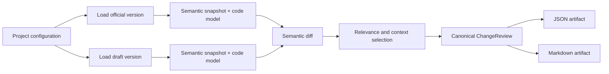

# Change Review

Change Review compares an official version of a SattLine project with a draft
version and produces one compact review that a human or an external reviewer can
read without the full source tree.

It is independent of static analysis. No analyzers run, no diagnostics are
collected, and the review never depends on analyzer results. It reuses the same
semantic snapshot and code model as the rest of SattLint.

## Workflow



The interactive **Change Review** view and the headless `sattlint review`
command are the two callers. Both use the same application entry point. It loops
over the configured or selected targets, generates a review for each target, and
reports per-target success or failure. The interactive view prints a human
summary; the headless command writes the same two artifacts and returns a
documented exit code.

## Loading both versions

Each version is loaded with the configured project roots:

1. The official version is loaded with official mode.
2. The draft version is loaded with draft mode.
3. Each load produces a semantic snapshot and a per-module code model.
4. The parsed tree and indexes that are no longer needed are released before
   the second version is loaded.

Each version is parsed exactly once per review. The semantic diff, relevance
analysis, and context extraction all reuse those snapshots.

## Semantic diff

The diff is driven by the semantic model, not by text:

- symbol definitions;
- the per-module code model;
- call signatures;
- statement structure and expressions;
- module parameter connections;
- dependencies;
- sequence structure and transitions.

Comparison uses span-normalized fingerprints, so formatting, layout, and
source offsets that do not change meaning never become changes. Raw text is used
only as a presentation detail when a snippet is attached.

A change records, where applicable:

- the affected symbol and module path;
- the kind of change;
- a detail description;
- the official and draft values;
- source locations;
- the containing block;
- statement context;
- read and produced keys;
- sequence name and previous and next state;
- the semantic context selected by impact analysis.

## Impact and context selection

Equation blocks and sequences are the units of behavioral context. For every
change, the impact pass selects, bounded to one expansion level:

1. the variables directly read or written by the changed statement or
   expression;
2. the complete containing equation block or sequence;
3. every other equation block or sequence that reads or writes a directly
   involved variable;
4. the definitions of all variables used by the selected blocks;
5. a deduplicated union across all changes.

Direct reads and writes come from the changed statement itself, resolved against
the module that declares the code. Variables used by selected blocks are broader
context and are never reported as direct reads or writes.

A block that used a variable before the draft edit remains in the context even
when the draft no longer uses it. The review explains that it belonged to the
official revision, so a removed use still has surrounding context.

## Review model

The canonical review contains:

- project metadata: project name, official revision, draft revision, generation
  timestamp;
- the semantic changes, each with its semantic context;
- context blocks with their role, reasons, reads, writes, source locations, and
  official or draft source;
- variable definitions involved in the changes;
- size statistics.

A context block is one complete equation block or sequence. Its role is either
the changed block or a related block, and it carries an explicit reason for
inclusion.

The model is presentation-independent. JSON, Markdown, the terminal UI, and an
external reviewer all consume the same review.

## Artifacts

For each target, two artifacts are written into the selected review output
directory:

- `<project>-change-review-<timestamp>.json`
- `<project>-change-review-<timestamp>.md`

The timestamp is UTC and comes from the review metadata, so the file name and
the content agree. The artifact base name sanitizes characters that are not safe
in a file name.

The review directory is dedicated to these artifacts. It is created owner-only
with mode `0700`, and an existing broader mode is narrowed to `0700`. Both
artifacts are written atomically with mode `0600`, so a source excerpt is not
readable by other local users.

The JSON artifact is the structured contract. The Markdown artifact is the
human-readable review. Both are generated from the same review object.

## Headless command

`sattlint review` generates the same artifacts without the interactive UI.

| Option | Effect |
| --- | --- |
| `--project PATH` | Project file or a directory containing one. |
| `--target NAME` | Review only this target; repeatable. Defaults to every configured target. |
| `--output-dir PATH` | Directory for the artifacts. Defaults to the configured review directory. A missing directory is created. |
| `--format {json,text}` | Report format; default `text`. |
| `--output PATH` | Write the report to a file instead of stdout. The artifacts still go to the review output directory. |
| `--quiet` | Suppress progress and diagnostics on stderr. |

The report contains the resolved output directory and the absolute path of every
generated artifact. A relative `--output-dir` resolves against the current
working directory. The headless report adds no source paths to the artifacts
themselves; their contents stay exactly what the review engine writes.

### Exit codes

| Code | Meaning |
| --- | --- |
| `0` | Every selected target generated both artifacts. |
| `1` | At least one target generated artifacts and at least one failed (partial). |
| `2` | Missing project, no configured or selected target, unusable output directory, or a usage error. Nothing was generated. |

The command never returns `0` when it generated no artifact. A full failure uses
the normal CLI error envelope and names each failed target.

### JSON report

```json
{
  "schema_version": 2,
  "command": "review",
  "project": "/workspace/app.slproj",
  "output_dir": "/workspace/change-review",
  "targets": [
    {
      "target": "Demo",
      "json": "/workspace/change-review/Demo-change-review-20261119T102030.123456Z.json",
      "markdown": "/workspace/change-review/Demo-change-review-20261119T102030.123456Z.md"
    }
  ],
  "failures": [],
  "generated_targets": 1,
  "failed_targets": 0
}
```

A partial review keeps the same document shape and adds one entry to `failures`
for each target that could not be reviewed. The artifact paths point at the
review output directory, not at source files.

### CI example

```yaml
- name: Generate Change Review
  run: sattlint review --project app.slproj --output-dir change-review --format json --quiet

- name: Upload Change Review
  if: always()
  uses: actions/upload-artifact@v4
  with:
    name: change-review
    path: change-review/
```

The step fails on a partial review (`1`) and on a missing project or target
(`2`), so an incomplete review never reaches the upload step as a success. Use
`if: always()` on the upload so the artifacts from a partial review are still
available for inspection.

## Size statistics

The review reports:

- the total source size of both versions;
- the selected source size;
- the metadata size;
- the artifact size;
- the source reduction percentage;
- the number of semantic changes;
- the number of relevant blocks;
- the number of relevant variables;
- the number of contextual blocks.

These values describe how much of the project the review selected, not a quality
score.

## Output location

`review.output_dir` in the user configuration selects the output directory:

- empty: `<config dir>/change-review`;
- absolute: used as written;
- relative: resolved against the configuration directory.

The directory is created on demand. The **App Settings** view can change the
location. For a single headless run, `--output-dir PATH` overrides the
configured location without changing the configuration.

## Failure handling

Each target is reviewed independently. If one target fails, the application
reports the failure and continues with the remaining targets. The operation
fails only when every target fails.

- The interactive view raises an error only when every target fails and
  otherwise prints the per-target summary.
- `sattlint review` exits `1` when some targets succeeded and some failed, and
  `2` when no artifact was generated.

A review is not a substitute for analysis. It does not report defects; it
surfaces semantic changes and the behavior around them.

## Related pages

- [CLI reference](cli.md)
- [Interactive UI](interactive-ui.md)
- [Resolution and semantics](resolution-and-semantics.md)
- [Configuration](configuration.md)
- [Project loading](project-loading.md)
