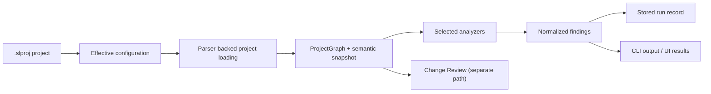

# Overview

SattLint is a Python toolkit for SattLine projects. It loads a SattLine project
through the external `sattline-parser` package, indexes the result into a
semantic project graph, and runs selected analyzers over that graph. It ships
two user surfaces:

- an interactive Textual terminal UI, started by running `sattlint` with no
  arguments;
- a non-interactive command line for scripts, CI jobs, and agents, started by
  running `sattlint <command>`.

The repository also contains a Change Review capability that compares an
official project version with a draft version and produces a compact JSON and
Markdown review. Change Review is independent of static analysis: it shares the
semantic loading layer but runs no analyzers.

## What SattLint does

- Parses and validates SattLine source through the parser package.
- Resolves programs, libraries, dependency closures, graphics companions, and
  ICF configuration files.
- Runs explicit, independently selected analyzers over a loaded target.
- Normalizes analyzer output into one finding model with stable identities.
- Stores completed runs so results can be queried without analyzing again.
- Produces Change Review artifacts for an official and a draft project version.

## What SattLint does not do

- It does not own the SattLine grammar, AST models, or parser-owned language
  validation. Those belong to the external `sattline-parser` package.
- It does not provide a project validation command that replaces the parser's
  own validation surface.
- It does not edit SattLine source files.
- It does not contact a network service during analysis.

## Supported environment

- Windows or Linux.
- Python 3.13 or newer.
- A local SattLine codebase and a `.slproj` project file that describes it.

## Product surfaces

| Surface | Entry point | Purpose |
| --- | --- | --- |
| Interactive shell | `sattlint` | Configure a project, run analyzers, browse results, generate a Change Review. |
| Headless CLI | `sattlint project show`, `analyzers list`, `analyze`, `findings`, `show` | Automation with JSON, NDJSON, or text output. |
| Change Review | Interactive Output view | Semantic diff plus surrounding behavior context for official versus draft code. |
| Analyzer registry | `sattlint analyzers list` | The single catalog of selectable analyzers. |

## Design decisions that shape the code

**The parser owns the language.** File discovery, official/draft resolution,
dependency recursion, parsing, syntax validation, and graphics scanning live in
`sattline-parser`. SattLint owns workspace policy, the analysis index, the
analyzers, and presentation.

**Projects are portable.** A `.slproj` file captures targets, directories,
mode, string capacities, analyzer selection, and analyzer settings. Paths in
the file resolve relative to the file, not to the current working directory.

**Analyzer selection is explicit.** There is no hidden default analyzer set. A
run names its analyzers with `--analyzer` or with the project's `analyzers`
list. This keeps a checked-in project reproducible.

**Analyzers are isolated.** Each analyzer receives one `AnalysisContext` and
returns one report. Selection is exact: nothing is added, dropped, reordered,
or merged into another analyzer. Shared semantic artifacts are an optimization,
not a dependency contract.

**Findings are one model.** Every report is normalized into a typed finding
with a kind, message, module path, optional rule identifier, explanation,
suggestion, and structured data. The CLI, the UI, and run history consume the
same shape.

**Caches are an optimization, never a requirement.** An unavailable cache
directory degrades to an uncached run. Cache entries are signed, versioned, and
validated against a file manifest before reuse.

**The same code serves the UI and the CLI.** Both surfaces drive the
application layer, so the Analyze view and `sattlint analyze` share selection,
loading, execution, persistence, and result construction.

## The high-level flow

## Where to go next

- New user: [Getting started](getting-started.md).
- Project author: [Project files](project-files.md) and
  [Configuration](configuration.md).
- Automation author: [CLI reference](cli.md).
- Analyzer author or maintainer: [Analyzers](analyzers.md),
  [Analysis pipeline](analysis-pipeline.md), and
  [Development](development.md).
- Code reader: [Architecture](architecture.md).
