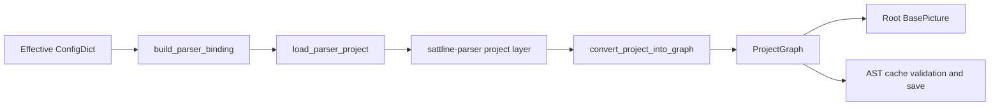

# Project Loading

Project loading turns a `.slproj` configuration and a bare target name into a
`BasePicture` plus a `ProjectGraph`. All SattLine source reading happens in the
external parser package; SattLint owns the binding, the diagnostic policy, the
indexing, and the cache.

## The loading stack

| Module | Responsibility |
| --- | --- |
| `project/loader_config.py` | Validate the loader keys and coerce them into a parser binding. |
| `project/parser_adapter.py` | Call the parser, translate diagnostics, attach graphics, and index the result. |
| `project/loading.py` | Orchestrate target selection, cache lookup, reverse consumers, and graph construction. |
| `project/loading_support.py` | Failure recording, warning recording, timings, and debug summaries. |
| `project/cache.py` | Bridge from the analysis report cache to the project loader. |
| `project/support.py` | Target lists, ICF file discovery, cache keys, warning printing. |

## Parser binding

`build_parser_binding` requires these keys:

- `program_dir`
- `other_lib_dirs`
- `ABB_lib_dir`
- `mode`
- `debug`

It also reads the effective string capacity table.

The binding contains:

- the primary program root;
- the ABB library root, when set;
- additional library roots in search order;
- the load mode (`official` or `draft`);
- an optional debug sink;
- optional status and timing sinks;
- the string capacities.

The parser may keep its own per-file lookup and AST caches under the project
cache root. It refuses a directory it cannot prove private to the user and
falls back to an in-memory load, so the parser cache is an optimization rather
than a correctness dependency. SattLint separately caches the resulting project
graph and analyzer reports.

## Load sequence

A target load follows this sequence:

1. Validate the loader configuration.
2. Resolve the configured targets and select the requested target, or the first
   configured target.
3. Compute the project cache key.
4. If caching is enabled, validate and load a cached graph.
5. Build the parser binding.
6. Load the target's complete declared closure through the parser.
7. Record parser failures and warnings as typed graph state.
8. For library targets, include reverse library consumers.
9. Merge module-type and datatype definitions into the target view.
10. Build the cache manifest and store the graph when the load is complete.

A cached graph is returned only when its file manifest still matches the files
on disk. A cached entry also records that it came from cache so timing fields
are not reported as fresh measurements.

## Official and draft modes

`mode` selects which file variant the parser resolves:

- `official` resolves official source files;
- `draft` resolves draft source files.

The mode is part of the project cache key and is compared case-insensitively.
It also participates in target existence checks and Change Review loading.

## Dependency closure

The parser owns discovery and recursion:

- it resolves a program's declared dependency sidecars;
- it follows the closure across program, ABB, and additional library roots;
- it reports a circular dependency or a version-conflict condition when the
  closure cannot be completed.

SattLint does not reimplement dependency traversal. It reads dependency names
through the parser adapter when it needs to reason about consumers and it
records parser failures in the graph.

## Reverse library consumers

When the selected target is a library, SattLint loads the units that consume the
library and indexes them too. This makes workspace-wide checks such as
module-type usage and datatype-field usage able to see real consumers.

The loader batches the reverse consumers into one parser load so a shared
dependency closure is parsed once. If the batch cannot load because one
consumer is broken, the loader retries each consumer individually and records
the failures without discarding the consumers that do load.

Reverse consumers are loaded with strict validation disabled. They are context
for the selected library, not the subject of the run.

## What the graph contains

`ProjectGraph` is the analysis index:

- `ast_by_name`: every parsed base picture by name;
- `root_origins`: the source path and library that identify a root program;
- `moduletype_defs` and `datatype_defs`: definitions keyed by library, name,
  and file so same-named types from different libraries coexist;
- `library_dependencies` and `source_dependencies`;
- `missing`: names that were not resolved;
- `warnings`: non-fatal load notices;
- `failures`: typed failure records with message and location;
- `unavailable_libraries`: libraries that could not be read;
- `source_files` and `source_file_libraries`;
- cache metadata;
- load and graphics timings;
- graphics attachments for each program.

The root view returned to analyzers is the root base picture with the merged
module-type and datatype definitions.

## Graphics companions

The parser scans graphics companions and returns a graphics model. SattLint
attaches the correlated record shapes to the graph:

- graphics bindings;
- graphics messages;
- composite records and occurrences;
- PictureDisplay records and occurrences;
- PictureDisplay path diagnostics.

SattLint also owns the workspace checks that need local files, such as verifying
that a literal PictureDisplay asset exists next to the program or in its screen
subdirectory. External drawing assets that cannot be inspected are skipped.

## Failures and warnings

Loading intentionally distinguishes conditions:

- **Missing program**: a declared unit could not be found.
- **Load failure**: a program exists but could not be parsed or validated.
- **Unavailable library**: a library root could not be read.
- **Warning**: a non-fatal notice attached to the graph.

An unmatched target does not produce a partial analysis. The loader records the
failure and the application layer decides whether to continue with other
targets or fail the command. The headless `analyze` command treats an unloaded
selected target as a target-loading error.

Parser diagnostics that belong to the parser's own validation surface are not
copied into the analysis result. They are translated into SattLint policy only
where SattLint has a decision to make. Structural findings that SattLint can
prove are left to the owning analyzer.

## Program batches for ICF

ICF validation references programs that are often not analysis targets. Loading
them one at a time would parse a shared dependency closure once per program.

`load_program_asts` loads a set of programs in one parser pass and caches the
result against a synthetic identity built from the exact program set. The cache
key includes the parser version, configuration, and string capacities, and the
manifest tracks the source files involved.

## AST cache integration

The project loader uses `ASTCache` through the cache bridge:

- the project cache key covers the parser version, load mode, roots, targets,
  string capacities, and other load-affecting settings;
- the manifest covers source files, graphics companions, distribution
  companions, dependency sidecars, and the ICF directory and files;
- a manifest mismatch is a cache miss;
- an incomplete graph with unavailable libraries or load failures is not saved;
- a cache write failure is logged and the run continues.

A failed load reports a bounded set of details: each list is capped at 12
entries and the remainder is stated as a count. The typed failure record names
the target, distinguishes a resolution failure from an unreadable file and a
parse failure, and carries the file, line, and column when the parser supplied
them.

A cache is an optimization. An unusable cache directory degrades to an uncached
load instead of stopping the run.

Full cache details are in [Caching and runs](caching-and-runs.md).

## Related pages

- [Project files](project-files.md)
- [Analysis pipeline](analysis-pipeline.md)
- [Resolution and semantics](resolution-and-semantics.md)
- [Caching and runs](caching-and-runs.md)
